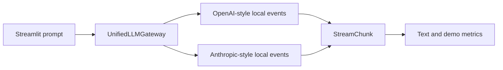

# Multi-provider gateway, offline demo

This is a **simulation for AD331**. It does not call OpenAI or Anthropic. The two adapters imitate their different streaming event shapes and return local sample text. Token counts are simple local estimates. The displayed cost uses fixed illustrative rates and is **not a bill or an official provider price**. This distinction matters: the course assignment asks for official async SDKs, real provider usage data, and a live comparison. This project does not meet those parts of the rubric.

## How it works



`gateway.py` contains both local adapters and normalizes their events into a Pydantic `StreamChunk`. The same code computes time to first text, elapsed time, speed, estimated tokens, and hypothetical cost for either style. `schemas.py` defines the response types. `pricing.py` holds the illustrative rates. `app.py` is the Streamlit interface. No account, key, internet connection, or paid API is needed while the app runs.

## Run it

Use Python 3.11 or newer. From this folder:

```sh
python3 -m venv .venv
source .venv/bin/activate
pip install -e '.[test]'
streamlit run src/app.py
```

Alternatively, with `uv`:

```sh
uv venv --python 3.11
source .venv/bin/activate
uv pip install -e '.[test]'
streamlit run src/app.py
```

Open the local URL Streamlit displays, normally `http://localhost:8501`. Pick a provider style and demo model, enter a prompt, and click **Run offline demo**. The text arrives in small pieces. The metrics update as it arrives. The temperature slider is shown to demonstrate the requested control, but it does not affect the fixed sample replies. Check **Show a safe demo error** to demonstrate error handling without using a real key.

Run the tests:

```sh
pytest -v
```

For a local container demo, if Docker is installed and running:

```sh
docker compose up --build
```

Then open `http://localhost:8501`. Stop it with Ctrl+C. Docker is optional for ordinary local use.
While the container is running, test that same build with:

```sh
docker compose exec -T gateway-demo pytest -v
```

## Configuration and safety

`.env.example` explains that keys are unused in this version. Do not put real keys in the demo. `.env` is ignored by Git. The example error uses no key. The app does not send prompts to any AI service, but it does display a generic local reply. Avoid entering private information anyway.

## Illustrative pricing matrix

These are **made-up classroom rates**, in USD per million estimated tokens. They are not current provider prices.

| Demo model | Input | Output |
| --- | ---: | ---: |
| OpenAI-style / small demo | $0.20 | $0.80 |
| OpenAI-style / large demo | $1.50 | $6.00 |
| Anthropic-style / small demo | $0.25 | $1.25 |
| Anthropic-style / large demo | $2.00 | $10.00 |

The display computes `(estimated input tokens × input rate + estimated output tokens × output rate) / 1,000,000`, rounded to six decimal places. A token estimate here is a word or punctuation group. It is not the same as an actual model tokenizer or provider usage report.

## Audit and verification

The first implementation was generated with AI and then reviewed. Two real issues were found and fixed: it echoed user prompt text in the sample response, and the first speed reading divided by a near-zero interval. The exact changes are in [ai_prompt_log.md](ai_prompt_log.md). The tests cover both adapters, normalized chunks, metrics, safe errors, and cost formatting. They run offline and do not prove live provider integration.

## Files

- `src/gateway.py`: simulated adapters and unified stream
- `src/schemas.py`: typed chunks and metrics
- `src/pricing.py`: illustrative prices and cost calculation
- `src/app.py`: web interface
- `tests/`: offline tests
- `Dockerfile`, `docker-compose.yml`: local container option
